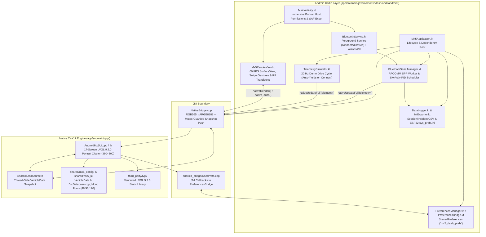

<p align="center">
  <a href="https://ko-fi.com/todd0042">
    
  </a>
</p>

---

# 📱 MX-5 Dash Android: Companion Telemetry App

[](https://github.com/Todd0042/mx5-dash-android/releases)
[](LICENSE)
[-3DDC84.svg?logo=android&logoColor=white)](https://developer.android.com)
[](app/src/main/cpp/CMakeLists.txt)
[](https://github.com/Todd0042/mx5-dash)
[](https://ko-fi.com/todd0042)

> **Turn any Android smartphone, tablet, or aftermarket head unit into a dedicated Mazda MX-5 Miata (ND2 / SkyActiv-G 2.0L) telemetry cluster — powered by a native C++17 LVGL 9.2.0 graphics engine, Bluetooth Classic RFCOMM OBD-II polling, and 17 portrait cockpit screens.**

```text
       _________________________________________________________________________
      |  MAZDA MX-5 MIATA (ND2)                     [GEAR: 4]     SPEED: 62 MPH |
      |  TACH [████████████████████░░░░░] 5,200 RPM  COOLANT: 198°F  OIL: 215°F |
      |_________________________________________________________________________|
      |  TPMS [FL: 30 PSI] [FR: 30 PSI]             0-60 MPH: 5.42s [BEST]      |
      |       [RL: 30 PSI] [RR: 30 PSI]             FUEL: 64%       AFR: 14.7   |
      |_________________________________________________________________________|
```

---

## 📖 Table of Contents

* **Part 1 — User Overview & Quick Start**
  * [🏎️ What Is MX-5 Dash Android?](#-what-is-mx-5-dash-android)
  * [⚡ How It Works in 3 Steps](#-how-it-works-in-3-steps)
  * [✨ Cockpit Highlights at a Glance](#-cockpit-highlights-at-a-glance)
  * [🧭 Screen Carousel & Gesture Navigation](#-screen-carousel--gesture-navigation)
  * [🚀 Quick Start, Build & Installation](#-quick-start-build--installation)
* **Part 2 — Technical Architecture & Reference**
  * [1. Dual-Layer System Architecture (AndroidManifest.xml, Mx5Application.kt, NativeBridge.cpp)](#1-dual-layer-system-architecture)
  * [2. Native C++17 / LVGL 9.2.0 Render Pipeline (AndroidMx5UI.cpp, Mx5RenderView.kt)](#2-native-c17--lvgl-920-render-pipeline)
  * [3. Bluetooth Classic RFCOMM Stack & ELM327 Protocol (BluetoothSerialManager.kt, BluetoothService.kt)](#3-bluetooth-classic-rfcomm-stack--elm327-protocol)
  * [4. SkyActiv-G 2.0L PID Scheduler, Transmission Detection & Telemetry Math (BluetoothSerialManager.kt)](#4-skyactiv-g-20l-pid-scheduler-transmission-detection--telemetry-math)
  * [5. Dynamic Hero Alerts, Built-In DTC Repair Guide & Live Simulator (DtcDatabase.cpp, TelemetrySimulator.kt)](#5-dynamic-hero-alerts-built-in-dtc-repair-guide--live-simulator)
  * [6. Preferences, CSV Datalogging & ESP32 `sys_prefs.ini` Export (PreferencesManager.kt, DataLogger.kt, IniExporter.kt)](#6-preferences-csv-datalogging--esp32-sys_prefsini-export)
  * [7. Shared C++ Core & ESP32-S3 Sister Project (shared/mx5_config/)](#7-shared-c-core--esp32-s3-sister-project)
  * [8. Repository Structure & Build Verification (app/build.gradle.kts, CMakeLists.txt)](#8-repository-structure--build-verification)
  * [9. License & Support (LICENSE)](#9-license--support)

---

# Part 1 — User Overview & Quick Start

## 🏎️ What Is MX-5 Dash Android?

**MX-5 Dash Android** (`com.mx5dash.obd2android`) is the standalone Android companion application for the **[MX-5 Dash](https://github.com/Todd0042/mx5-dash)** ESP32-S3 telemetry project.

Instead of requiring dedicated embedded display hardware in your center air vent, MX-5 Dash Android compiles the **C++17 / LVGL 9.2.0** gauge engine directly into an Android native library (`libmx5dash.so`) and presents a portrait `360×800` cockpit cluster scaled cleanly to any Android 8.0+ phone, tablet, or head unit:

* **Built-In Live Demo Mode on Launch**: Opens directly into a 20 Hz simulated SkyActiv-G drive cycle (`TelemetrySimulator`) so you can explore every screen, warning banner, and diagnostic chart at your desk before plugging into your car.
* **Automatic Handover to Live OBD-II**: As soon as a paired Bluetooth Classic SPP adapter connects, the simulator yields automatically to real-time CAN bus telemetry over ISO 15765-4 (11-bit, 500 kbps).
* **Self-Contained Android Project**: All shared telemetry structs, diagnostic code tables, custom monospaced bitmap fonts, and LVGL 9.2.0 sources are vendored directly inside this repository with zero external repo build dependencies.

---

## ⚡ How It Works in 3 Steps

1. **Pair Your Bluetooth Classic OBD-II Adapter**: Plug a Bluetooth SPP OBD-II dongle (such as a *Vgate vLinker MS / MC*, *OBDLink MX+*, *Veepeak*, *Carista*, *BAFX*, or standard *ELM327* adapter) into your Miata's OBD-II port and pair it in Android Bluetooth settings.
2. **Launch & Grant Bluetooth Permission**: Open **MX-5 Dash** on your portrait-mounted phone (`Android 8.0+` / API 26+). Grant **Nearby Devices / Bluetooth** permission (`BLUETOOTH_CONNECT`) when prompted so the foreground telemetry service can maintain a wake-locked RFCOMM link.
3. **Drive & Swipe**: The app auto-detects paired OBD adapters, probes whether your ND2 is a **6AT (Automatic)** or **6MT (Manual)**, and streams live speed, RPM, gear, fluids, 4-corner TPMS, fuel trims, and 0–60 MPH runs.

---

## ✨ Cockpit Highlights at a Glance

* **🏎️ High-Contrast Portrait Hero Cluster**: Massive 120px monospaced speed readout, segmented dotted arcs for RPM (with redline warning dots above 6,500 RPM), fuel level, and ambient temperature, plus live gear indicator (`P/R/N/D/1–6`).
* **🚨 Dynamic Hero Safety Takeover**: Automatically replaces the secondary dials on the Speed screen with a high-visibility alert panel when TPMS drops below `26.0 PSI` (or critical `<22.0 PSI`), coolant hits `>=226°F`, oil hits `>=252°F`, battery drops below `11.6V`, or an ECU DTC is present—with tap-to-dismiss for the drive.
* **🛞 4-Wheel OEM TPMS & Wheel Mapping**: Reads Mazda BCM tire pressure DIDs (`222A05`–`222A08`) and tire temperatures on header `720`, complete with a dedicated TPMS Wheel Calibration screen (`SCREEN_WHEEL_MAP`).
* **🌡️ SkyActiv-G Powertrain & Fuel Telemetry**: Live Engine Oil Temp (`221310`), Coolant Temp (`0105`), Intake Air Temp (`010F`), Battery Voltage (`0142` / `ATRV` fallback), Wideband AFR (`0124` / `0134`), STFT/LTFT, HPFP DI Fuel Rail Pressure (`0123` / `0122`), and Spark Advance (`010E`).
* **⏱️ Track & 0–60 MPH Launch Timer**: Automatic launch timer (`0` Ready → `1` Timing across `1–96 km/h` → `2` Finished at `>=97 km/h`) tracking current and session-best 0–60 MPH times alongside estimated HP, torque, throttle %, and deceleration braking %.
* **🛠️ On-Device DTC Repair Guide**: Built-in lookup table of 34 Mazda/SkyActiv-focused diagnostic trouble codes (plus dynamic SAE J2012 fallback classification) with meanings, inspection checklists, and repair notes.
* **🚗 Animated MX-5 RF Screen Transitions**: Smooth 60 FPS directional slide transitions with an animated MX-5 RF side silhouette featuring pulsing amber DRLs and Soul Red taillights while the background poller fetches fresh PIDs for the incoming screen.
* **💾 CSV Black-Box Datalogger & ESP32 `sys_prefs.ini` Export**: Automatically records rolling CSV telemetry sessions and incident snapshots to app external storage, and exports preferences as an ESP32-compatible `sys_prefs.ini` file.

---

## 🧭 Screen Carousel & Gesture Navigation

Swipe horizontally across the **7 primary content screens**, swipe vertically (up from the top 2/3 of the display, or down) to open the **Mazda Connect Menu Hub**, or press the Android **Back** button to toggle the menu:

| Index | Screen Name | Focus & Metrics |
| :---: | :--- | :--- |
| `0` | **Hero Speedometer** | 120px Speed (`MPH` / `km/h`), Gear (`P/R/N/D/1–6`), RPM/Fuel/Ambient dotted arcs, Dynamic Warning Takeover |
| `1` | **TPMS & Tire Temps** | 4-corner FL / FR / RL / RR pressures (`PSI`), tire temperatures (`°F`), status beacons, MX-5 RF chassis visual |
| `2` | **Temperatures & Fluids** | Coolant Temp, Oil Temp (`221310`), Intake Air Temp, Battery Voltage |
| `3` | **Diagnostic Hub** | Connection/battery status, stored DTC count, DTC repair modal trigger, entry to sub-dashboards `8–12` |
| `4` | **Track & Dynamics (FAFO)** | Automated `0–60 MPH` timer & best run, Throttle %, Engine Load %, estimated HP & Torque |
| `5` | **Engine Tachometer** | High-rate RPM dotted arc, Load %, Throttle %, Fuel %, Battery arc |
| `6` | **Fuel & Trip Economy** | Instantaneous MPG (with DFCO detection), Trip Average MPG, Trip Distance, Estimated Range, Fuel % |
| `7` | **Quick Launcher Menu** | 7-pod circular Mazda Connect launcher grid (`MPH`, `PSI`, `°F`, `OBD`, `0-60`, `RPM`, `MPG`) + Settings button |
| `8–12` | **Diagnostic Sub-Screens** | `8` Fuel Trims & HPFP, `9` Cylinders & Misfire, `10` Chassis Dynamics, `11` I/M Smog Readiness (8 monitors), `12` Data Logs & Black Box |
| `13–16` | **System & Calibration** | `13` System Settings, `14` OBD-II Adapter / BLE Status, `15` Setup Wizard, `16` TPMS Wheel Calibration |

> **Gesture Protection**: Swipe-up gestures starting in the bottom third of the screen (`y > 2/3 * 800`) are intentionally ignored by `Mx5RenderView` so Android's system navigation/home swipe gestures always work cleanly.

---

## 🚀 Quick Start, Build & Installation

### Prerequisites
* **Android SDK**: `compileSdk 35`, `minSdk 26` (Android 8.0+), `targetSdk 34`
* **Android NDK**: `27.2.12479018`
* **CMake**: `3.22.1`
* **JDK**: Java 17 (Gradle `8.14` wrapper included; Android Gradle Plugin `8.7.3`, Kotlin `2.0.21`)

### Build from Source

1. **Clone the repository**:
   ```bash
   git clone https://github.com/Todd0042/mx5-dash-android.git
   cd mx5-dash-android
   ```

2. **Configure your local Android SDK path** (`local.properties` is gitignored and machine-specific):
   ```properties
   # Create local.properties at the repository root:
   sdk.dir=/path/to/your/Android/Sdk
   ```

3. **Build the Debug APK**:
   ```bash
   ./gradlew assembleDebug
   ```
   The compiled APK is output to `app/build/outputs/apk/debug/app-debug.apk`.

4. **Install onto a connected Android device via `adb`**:
   ```bash
   adb install -r app/build/outputs/apk/debug/app-debug.apk
   ```

---
---

# Part 2 — Technical Architecture & Reference

> *The sections below provide a code-verified technical reference of the Kotlin transport/render host, JNI boundary, C++17 LVGL 9.2.0 UI engine, SkyActiv-G CAN polling scheduler, and storage subsystems.*

---

## 1. Dual-Layer System Architecture

MX-5 Dash Android cleanly separates Android OS hardware/lifecycle management (Kotlin) from deterministic gauge rendering and layout logic (C++17 + LVGL 9.2.0) across a minimal JNI boundary ([NativeBridge.kt](app/src/main/java/com/mx5dash/obd2android/bridge/NativeBridge.kt), [NativeBridge.cpp](app/src/main/cpp/NativeBridge.cpp)).



### Android Manifest & Runtime Components ([AndroidManifest.xml](app/src/main/AndroidManifest.xml), [Mx5Application.kt](app/src/main/java/com/mx5dash/obd2android/Mx5Application.kt), [MainActivity.kt](app/src/main/java/com/mx5dash/obd2android/ui/MainActivity.kt))
* **Permissions**: Declares legacy Bluetooth (`BLUETOOTH`, `BLUETOOTH_ADMIN` up to `maxSdkVersion="30"`), Android 12+ (`BLUETOOTH_CONNECT`, `BLUETOOTH_SCAN` with `neverForLocation`), `FOREGROUND_SERVICE`, `FOREGROUND_SERVICE_CONNECTED_DEVICE`, and `WAKE_LOCK`.
* **Fullscreen Portrait Lock**: `MainActivity` locks `android:screenOrientation="portrait"`, enables `FLAG_KEEP_SCREEN_ON` and `SYSTEM_UI_FLAG_IMMERSIVE_STICKY`, and maps hardware/gesture Back presses (`onBackPressed()`) to `NativeBridge.nativeToggleMenu()`.
* **Connection Status Pill ([activity_main.xml](app/src/main/res/layout/activity_main.xml))**: Floating top overlay (`connStatusPill`) displays `"SEARCHING FOR OBD-II SCANNER…"`, `"CONNECTING TO …"`, `"OBD-II DISCONNECTED • RECONNECTING…"`, or `"LIVE OBD-II • <device>"` (which auto-fades out after `3000ms` once connected). Tapping the pill while disconnected triggers `bluetoothManager.reconnectNow()`.

---

## 2. Native C++17 / LVGL 9.2.0 Render Pipeline

### JNI Framebuffer & Touch Plumbing ([NativeBridge.cpp](app/src/main/cpp/NativeBridge.cpp), [lv_conf.h](app/src/main/cpp/lv_conf.h), [lvgl_v9compat.h](app/src/main/cpp/lvgl_v9compat.h))
* **Offscreen RGB565 Rendering**: `NativeBridge_nativeInit` initializes `lv_init()`, registers a monotonic millisecond tick (`CLOCK_MONOTONIC`), allocates a partial `360 × 40` LVGL draw buffer (`LV_DISPLAY_RENDER_MODE_PARTIAL`), and flushes rendered tiles into `uint16_t gFrameBuffer[360 * 800]`.
* **Fast ARGB8888 Blit**: Each `nativeRender(outPixels, len)` call runs `gUi.update()` and `lv_timer_handler()` under `gRenderMutex`, then expands `gFrameBuffer` from `RGB565` (`LV_COLOR_16_SWAP 0`) into the Kotlin `IntArray` (`ARGB8888`) for `Bitmap.setPixels()`.
* **Pointer Input Mapping**: `Mx5RenderView.onTouchEvent()` transforms physical screen coordinates into `360×800` logical space using an inverted scaling `Matrix` (`inverseMatrix`) and passes press (`0`) / release (`1`) events to `nativeTouch()` under `gTouchMutex`.
* **Engine Compatibility Header**: `CMakeLists.txt` force-includes [lvgl_v9compat.h](app/src/main/cpp/lvgl_v9compat.h) on `AndroidMx5UI.cpp` to map pre-cleanup LVGL v9 chart API names (`lv_chart_set_axis_range`, `lv_chart_set_all_values`, `lv_chart_set_series_value_by_id`) onto LVGL `9.2.0`.

### 60 FPS `SurfaceView` & Directional MX-5 RF Transitions ([Mx5RenderView.kt](app/src/main/java/com/mx5dash/obd2android/ui/Mx5RenderView.kt))
`Mx5RenderView` drives a dedicated `Mx5RenderThread` (`~16ms` loop) with a 4-state transition machine:
1. **`IDLE`**: Renders the live `mainBitmap` (`360×800`) scaled proportionally onto the Obsidian `#0C0D0F` canvas and syncs `bluetoothManager.currentActiveScreen`.
2. **`SLIDING_OUT_SCREEN_A` (`200ms`)**: Captures the outgoing screen to `screenABitmap`, slides it off-screen with smoothstep easing, and drives the MX-5 RF side profile (`assets/mx5_rf_side_left.png` or `mx5_rf_side_right.png`, with vector fallback) toward center with pulsing amber DRL and Soul Red taillight glows.
3. **`HOLD_LOCK` (up to `750ms`)**: Holds the centered MX-5 RF silhouette with the target screen title while setting `bluetoothManager.targetTransitionScreen` so the OBD thread prioritizes PIDs for the incoming screen. Advances as soon as `isFreshPayloadReady` becomes `true` or `MAX_HOLD_TIMEOUT_MS` expires.
4. **`SLIDING_IN_SCREEN_B` (`200ms`)**: Captures the newly populated `screenBBitmap` and slides it into view as the MX-5 RF silhouette accelerates off-screen.

### 17-Screen Portrait UI Engine ([AndroidMx5UI.cpp](app/src/main/cpp/android_ui/AndroidMx5UI.cpp), [AndroidMx5UI.h](app/src/main/cpp/android_ui/AndroidMx5UI.h))
* **Signature Mazda Palette**: Uses `#0C0D0F` obsidian background, `#14161B` card panels, `#2A2D36` borders, `#D12229` Soul Red Crystal accents, `#10B981` OK green, `#F59E0B` warning amber, and `#EF4444` critical red.
* **Custom Typography & Assets**: Compiles `lv_font_mono_48`, `lv_font_mono_96`, and `lv_font_mono_120` alongside embedded C image descriptors (`mx5_rf_tpms_img.c`, `mx5_rf_cal_img.c`) and persistent top-right speed chips across screens.
* **Theme Modes**: Supports `THEME_AUTO`, `THEME_DAY`, and `THEME_NIGHT` via `applyThemeMode()`.

---

## 3. Bluetooth Classic RFCOMM Stack & ELM327 Protocol

Managed by [BluetoothService.kt](app/src/main/java/com/mx5dash/obd2android/bluetooth/BluetoothService.kt) and [BluetoothSerialManager.kt](app/src/main/java/com/mx5dash/obd2android/bluetooth/BluetoothSerialManager.kt):

* **Foreground Service & WakeLock**: `BluetoothService` runs as `FOREGROUND_SERVICE_TYPE_CONNECTED_DEVICE` with a low-priority ongoing notification (`CHANNEL_ID = "mx5_dash_bt_channel"`) and a `PARTIAL_WAKE_LOCK` (`mx5dash:telemetry_wakelock`) so Android Doze mode does not throttle live telemetry. Swiping the app from Recents triggers `onTaskRemoved()` for clean socket, simulator, and process shutdown.
* **Paired Adapter Discovery (`ADAPTER_PREFIXES`)**: Scans `adapter.bondedDevices` for names containing any of: `VLINK`, `V-LINK`, `OBD`, `ELM`, `CARISTA`, `SCANTOOL`, `VIECAR`, `BAFX`, `VEEPEAK`, `TONWON`, `KONNWEI`, `LELINK`, `EDIAG`, `BLUETOOTH`, `IOS-VLINK`, `NEXAS`.
* **RFCOMM SPP + Channel 1 Fallback**: Connects via standard Serial Port Profile UUID `00001101-0000-1000-8000-00805F9B34FB` and falls back to `createRfcommSocket(1)` via reflection if SDP lookup fails.
* **Broadcast Disconnect & Exponential Backoff**: Listens for `ACTION_ACL_DISCONNECTED`, `ACTION_ACL_DISCONNECT_REQUESTED`, and `ACTION_STATE_CHANGED`, reconnecting with capped backoff (`1s` to `5s`) and re-enabling `TelemetrySimulator` while offline.
* **`>` Prompt Synchronization & Watchdog**: `sendObdCommand()` drains stale residual bytes, sends `<CMD>\r`, waits strictly for the ELM327 `>` prompt (discarding partial frames on timeout and sending `\r` to resync), sleeps after `15` consecutive `NO DATA`/error responses (ECU asleep), and verifies dongle health with `ATRV` after `20` consecutive timeouts.
* **ELM327 Initialization Sequence**:
  ```text
  ATZ → ATE0 → ATL0 → ATH0 → ATS0 → ATAT2 → ATST32 → ATSP6 → ATSH 7E0
  ```
  Configures echo/linefeeds/headers/spaces off, fast adaptive timing, `200ms` Mode 22 timeout (`ATST32`), and ISO 15765-4 CAN 11-bit 500 kbps (`ATSP6`).

---

## 4. SkyActiv-G 2.0L PID Scheduler, Transmission Detection & Telemetry Math

### Automatic 6AT vs. 6MT Detection
Immediately after ELM327 initialization, `runPollingLoop()` probes the Transmission Control Module on header `7E1` with `221E12`. If a valid `621E12` (or non-error) frame returns, `trans_auto` is saved as `true` (`6AT` automatic); otherwise `false` (`6MT` manual), before restoring `ATSH 7E0`.

### Priority Speed Loop, View-Driven Queue & Interleaved Background Sweep
To keep the speedometer fluid without starving background safety checks:
1. **Every Cycle (~20 Hz)**: Polls Vehicle Speed (`010D`) on `7E0`, followed by a `20ms` yield.
2. **View-Driven Screen Queue (`executeScreenQueue`)**: Polls only the PIDs needed by `activeScreen` (prioritizing `targetTransitionScreen` during swipe transitions):
   * **Screen 0 (Speed)**: `010C` (RPM), `7E1:221E12` (TCM PRND/Gear on 6AT), `012F` (Fuel %), `0104` (Engine Load %).
   * **Screen 1 (TPMS)**: `720:222A05`–`222A08` (4-wheel PSI & temp), `7E1:221E12` (PRND on 6AT), `0146` (Ambient Temp).
   * **Screen 2 (Temps)**: `0105` (Coolant), `221310` (SkyActiv Oil Temp), `010F` (Intake Air), `0142` (ECU Voltage with `ATRV` fallback).
   * **Screen 3 & 8 (Diagnostics / Fuel & HPFP)**: `0106` (STFT), `0107` (LTFT), `0123`/`0122` (Fuel Rail PSI), `0124`/`0134` (AFR), `010E` (Spark Advance), `0132` (EVAP vapor Pa on Screen 8).
   * **Screen 4, 5, 9, 10 (Track / Tach / Cyl / Chassis)**: High-rate cycling of `0111` (Throttle), `010C` (RPM), `0104` (Load), `010E` (Spark Advance).
   * **Screen 6 (Trip)**: `012F` (Fuel %) and `0104` (Load %).
   * **Screen 11 & 12**: `0101` (I/M Smog Readiness) and `03` (Stored DTCs).
3. **Interleaved Background Safety Rotation (`executeNextBackgroundQuery`)**: Every `2.5s`, executes **one** of 10 rotating background queries (Coolant `0105`, Oil Temp `221310`, Ambient `0146`, Battery `0142`/`ATRV`, Intake `010F`, TPMS `222A05`–`222A08` on `720`, and TCM `221E12` on `7E1`), skipping metrics already polled by the active screen.

### ND2 Calibration & Derived Telemetry (`pushTelemetrySnapshot`)
* **Throttle Idle Deadband (`parseCalibratedThrottle`)**: Maps raw `0111` byte values `<= 13%` to `0%` and scales `13%–100%` linearly to `0%–100%`.
* **Fuel Level Calibration (`parseCalibratedFuel`)**: Scales raw `012F` byte counts from `8` (reserve empty) to `224` (full) into `0%–100%`.
* **Gear Decoding & Ratio Fallback**: Uses TCM `221E12` (`0x60`=`R`, `0x70`=`P`, `0x50`=`N`, `1..6`=`D1–D6`) when available, falling back to `RPM / speedKmh` ratio thresholds calibrated for the `2.866` final drive on both the **SkyActiv-Drive RC6A-EL 6AT** and **SkyActiv-MT 6MT**.
* **0–60 MPH Timer, Braking % & Trip MPG**: Integrates speed-derived deceleration (`accelMps2 < -0.6 m/s²` with `<5%` throttle) into `liveBrakePct`, times `1–96 km/h` runs to `>=97 km/h` (saving `best0to60` for `3.0s–15.0s` runs), detects Deceleration Fuel Cut-Off (`DFCO` → `60.0 MPG`), and integrates `tripTotalDistanceMiles`, `liveTripAvgMpg`, and `rangeMiles`.

---

## 5. Dynamic Hero Alerts, Built-In DTC Repair Guide & Live Simulator

### Hero Screen Warning Takeover (`AndroidMx5UI::updateSpeedScreen`)
While keeping the primary 120px speed readout and gear indicator visible at all times, `updateSpeedScreen()` switches the lower right container to a warning panel (dismissible for the current drive by tapping the banner) in priority order:
1. **Low / Critical TPMS**: Triggered when any tire reports `4.0 < PSI < 26.0` (amber/red) or `< 22.0` (critical red), displaying all 4 corner PSI pods and `mx5_rf_tpms_dsc`.
2. **Engine Overheat**: Triggered at `Coolant >= 226°F` or `Oil Temp >= 252°F`.
3. **Low Battery Voltage**: Triggered when `5.0V < batteryVolts < 11.6V`.
4. **Stored ECU DTCs**: Triggered when `dtcCount > 0`.

### On-Device DTC Database ([DtcDatabase.h](app/src/main/cpp/shared/mx5_config/DtcDatabase.h), [DtcDatabase.cpp](app/src/main/cpp/shared/mx5_config/DtcDatabase.cpp))
Includes **34 explicit OBD-II / SkyActiv-G diagnostic entries** (fuel trims, MAF/MAP/IAT, HPFP rail pressure `P0087`/`P0088`/`P0191`, VVT camshaft timing `P0011`–`P0016`, cylinder misfires `P0300`+, catalysts, EVAP, O2 sensors) with title, category, ECU meaning, physical inspection steps, and repair guidance, plus automatic SAE J2012 prefix classification (`P/C/B/U` + subsystem digit) for unlisted codes.

### 20 Hz Telemetry Simulator ([TelemetrySimulator.kt](app/src/main/java/com/mx5dash/obd2android/simulation/TelemetrySimulator.kt))
Started automatically in `Mx5Application.onCreate()` when no physical adapter is connected:
* Runs a 60-second drive cycle up to `215 km/h` (`134 MPH`) across 6MT gear ratios.
* Simulates realistic temperatures, throttle/load curves, deceleration braking, `5.42s` (`5.28s` best) 0–60 MPH runs, AFR/STFT/LTFT/HPFP rail pressure, and a Front-Left low tire alert (`21.8 PSI` during `cycle < 25.0s`) to exercise the TPMS warning takeover.

---

## 6. Preferences, CSV Datalogging & ESP32 `sys_prefs.ini` Export

* **Bidirectional JNI Preferences ([PreferencesManager.kt](app/src/main/java/com/mx5dash/obd2android/storage/PreferencesManager.kt), [PreferencesBridge.kt](app/src/main/java/com/mx5dash/obd2android/bridge/PreferencesBridge.kt), [UserPrefs.cpp](app/src/main/cpp/android_bridge/UserPrefs.cpp))**: Stores settings in `mx5_dash_prefs` `SharedPreferences` (`rotation`, `units_us`, `theme_mode`, `brightness`, `auto_log`, `speed_mask`, `trans_auto`, `ble_prefix`, `ble_scan_tmo`, `is_configured`, `tpms_enabled`, and `wheel_did_0..3` defaulting to `2A05`, `2A08`, `2A0B`, `2A0E`). Note: `trans_auto` from the 7E1 probe is stored separately in `sys_prefs`.
* **Session & Incident CSV Datalogger ([DataLogger.kt](app/src/main/java/com/mx5dash/obd2android/storage/DataLogger.kt))**: Writes rolling session files under `<ExternalFilesDir>/sessions/session_yyyyMMdd_HHmmss.csv` (`timestamp,rpm,speed_kmh,coolant_c,load_pct,throttle_pct,fuel_pct,bat_volts,afr,knock_deg`) and copies incident snapshots into `<ExternalFilesDir>/incidents/`. (In C++ UI Sub-Screen 12, [SdLogger.cpp](app/src/main/cpp/android_bridge/SdLogger.cpp) currently provides 3 sample incident curves for charting preview.)
* **ESP32 `sys_prefs.ini` Exporter ([IniExporter.kt](app/src/main/java/com/mx5dash/obd2android/storage/IniExporter.kt))**: Formats `[DISPLAY]`, `[LOGGING]`, `[COMMUNICATION]`, and `[TPMS]` sections byte-compatible with the ESP32-S3 SD card importer and writes via Android's Storage Access Framework (`CreateDocument`).

---

## 7. Shared C++ Core & ESP32-S3 Sister Project

This repository was split out of the parent **[mx5-dash](https://github.com/Todd0042/mx5-dash)** ESP32-S3 project and vendors the shared C++ headers, DTC database, and bitmap fonts locally under [app/src/main/cpp/shared/](app/src/main/cpp/shared/) (`Config.h`, `VehicleData.h`, `ObdSource.h`, `DtcDatabase.h`/`.cpp`, `UserPrefs.h`, `SdLogger.h`, and `lv_font_mono_{48,96,120}.c/.h`) so both repositories build completely independently.

Prefer a permanent physical gauge pod running on a Waveshare ESP32-S3 3.5" display in your ND2 air vent?  
👉 **[https://github.com/Todd0042/mx5-dash](https://github.com/Todd0042/mx5-dash)**

---

## 8. Repository Structure & Build Verification

```text
mx5-dash-android/
├── build.gradle.kts                             # Top-level Gradle plugins (AGP 8.7.3, Kotlin 2.0.21)
├── settings.gradle.kts                          # Root project name ("OBD2Android") & :app module
├── gradle.properties                            # JVM args, AndroidX, non-transitive R class
├── gradle/wrapper/gradle-wrapper.properties     # Gradle 8.14 distribution config
├── LICENSE                                      # PolyForm Noncommercial License 1.0.0 (Copyright (c) 2026 Todd0042)
├── NOTES.md                                     # Architecture & post-split handoff notes
└── app/
    ├── build.gradle.kts                         # SDK 35/34/26, NDK 27.2.12479018, ABIs (arm64-v8a, x86_64), CMake 3.22.1
    └── src/main/
        ├── AndroidManifest.xml                  # BT permissions, MainActivity portrait lock, BluetoothService
        ├── assets/                              # mx5_rf_side_left.png, mx5_rf_side_right.png, mx5_rf_tpms.png
        ├── res/                                 # activity_main.xml, colors.xml, strings.xml, themes.xml, mipmaps
        ├── java/com/mx5dash/obd2android/
        │   ├── Mx5Application.kt                # App entry point, JNI init, simulator startup
        │   ├── bluetooth/
        │   │   ├── BluetoothSerialManager.kt    # RFCOMM SPP client, ELM327 init, SkyActiv PID scheduler & math
        │   │   └── BluetoothService.kt          # Foreground connectedDevice service & PARTIAL_WAKE_LOCK
        │   ├── bridge/
        │   │   ├── NativeBridge.kt              # JNI declarations for libmx5dash.so
        │   │   └── PreferencesBridge.kt         # SharedPreferences ('mx5_dash_prefs') wrapper for C++
        │   ├── simulation/
        │   │   └── TelemetrySimulator.kt        # 20 Hz 60-second MX-5 drive-cycle simulator
        │   ├── storage/
        │   │   ├── DataLogger.kt                # Rolling session & incident CSV writer
        │   │   ├── IniExporter.kt               # ESP32-compatible sys_prefs.ini generator & SAF exporter
        │   │   └── PreferencesManager.kt        # Typed Kotlin preferences facade
        │   └── ui/
        │       ├── MainActivity.kt              # Immersive host activity, BT permission flow, status pill
        │       └── Mx5RenderView.kt             # 60 FPS SurfaceView render thread, swipe gestures & RF transitions
        └── cpp/
            ├── CMakeLists.txt                   # Builds lvgl, mx5_engine, and libmx5dash.so (16 KB ELF aligned)
            ├── NativeBridge.cpp                 # JNI bridge, RGB565→ARGB8888 conversion & LVGL tick/input
            ├── AndroidObdSource.h               # Mutex-protected VehicleData source implementation
            ├── lv_conf.h                        # LVGL 9.2.0 configuration (16-bit RGB565, no swap)
            ├── lvgl_v9compat.h                  # LVGL 9.2.0 chart API compatibility macros
            ├── android_bridge/                  # Arduino.h, IPAddress.h stubs; UserPrefs.cpp, SdLogger.cpp
            ├── android_ui/                      # AndroidMx5UI.cpp/.h (17 screens), mx5_rf_tpms_img.c, mx5_rf_cal_img.c
            ├── shared/
            │   ├── mx5_config/                  # Config.h, VehicleData.h, ObdSource.h, DtcDatabase.*, UserPrefs.h, SdLogger.h
            │   └── mx5_ui/                      # lv_font_mono_48.c/.h, lv_font_mono_96.c/.h, lv_font_mono_120.c/.h
            └── third_party/lvgl/                # Vendored LVGL 9.2.0
```

### Build & Verification Commands

```bash
# Assemble debug APK (arm64-v8a & x86_64 native libs + Kotlin):
./gradlew assembleDebug

# Assemble release APK (unsigned unless keystore is configured):
./gradlew assembleRelease

# Clean native C++ (CMake/NDK) and Gradle build outputs:
./gradlew clean
```

---

## 9. License & Support

Licensed under the [PolyForm Noncommercial License 1.0.0](LICENSE) — free for personal, hobby, educational, research and nonprofit use; commercial use (inside a company, in a paid product or service, or for profit) requires a separate license from [Todd0042](https://github.com/Todd0042).

**Media License**: the images, artwork and audio made for this project (paths listed in [LICENSE-MEDIA](LICENSE-MEDIA)) are © Todd0042 under **[CC BY-NC 4.0](LICENSE-MEDIA)**: free to share and adapt with credit for non-commercial purposes; commercial use requires permission.

<p align="center">
  If you enjoy driving with MX-5 Dash Android, consider supporting its development:<br/><br/>
  <a href="https://ko-fi.com/todd0042" target="_blank">
    
  </a>
</p>

---

<p align="center">
  <a href="https://ko-fi.com/todd0042">
    
  </a>
</p>
